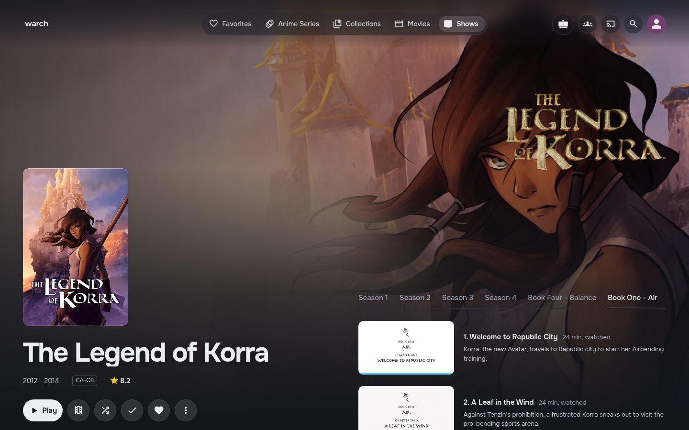
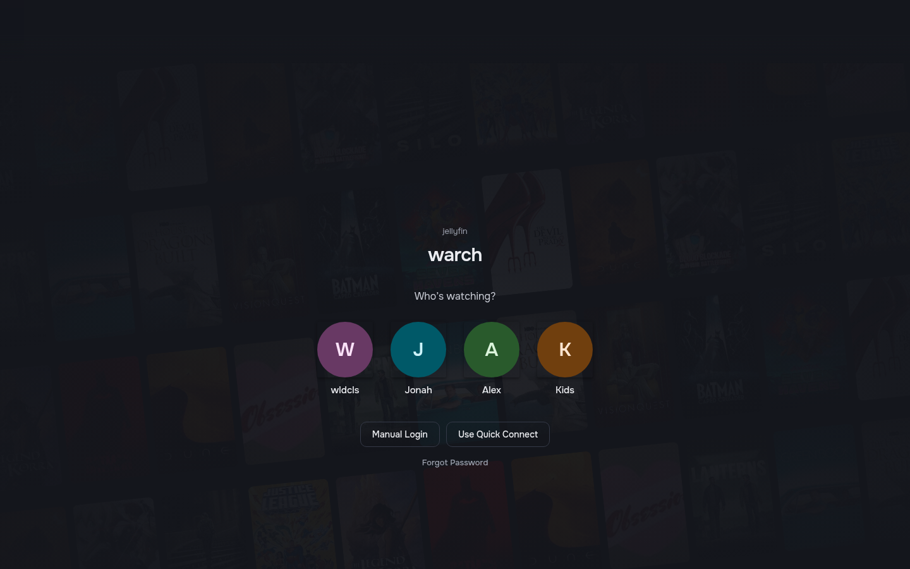
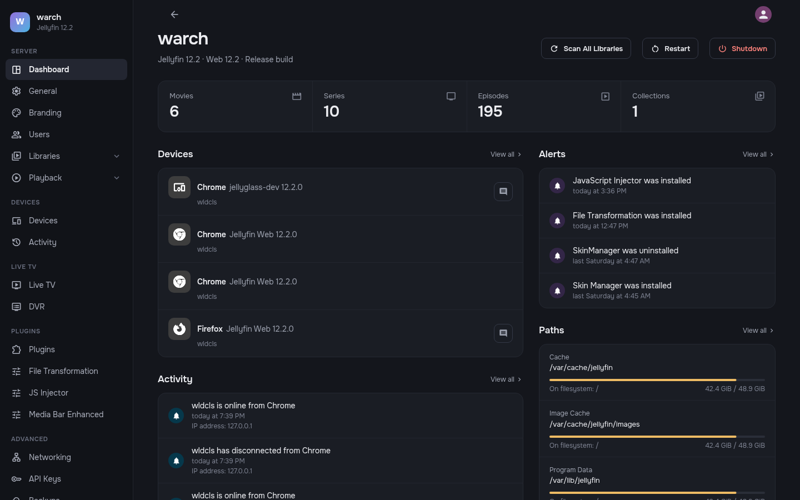
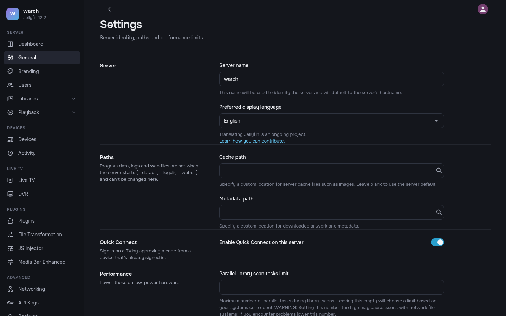

# jellyglass

A dark, glassy theme for the Jellyfin web client. It uses Onest type, rounded Material Symbols and a soft
sheen over all artwork. It is plain CSS plus one optional script: nothing on the server is patched, and
removing it restores the stock look.

Built and checked against jellyfin-web 12.2 (the layout with the Material UI header).







## Install

**Theme.** Dashboard → General → Custom CSS, add:

```css
@import url("https://cdn.jsdelivr.net/gh/leykhins/jellyglass@main/theme/jellyglass.css");
```

Save and reload the web client. Keep **Dark** selected under Settings → Display, because the theme loads on top of it.

**Script (optional).** `theme/jellyglass.js` draws the parts CSS can't:
- My Media posters and item counts;
- clickable hero slide bars;
- season tabs and an episode list on series pages;
- a bottom tab bar on phones;
- initials and a poster wall on the sign-in page;
- the admin dashboard theme (see below).

Without it, the theme still works. To install it, add the **JavaScript Injector** plugin (which needs
**File Transformation**). Add a script with *Requires authentication* **unticked**, so it also runs on the sign-in
page, and paste:

```js
(function () {
  var s = document.createElement("script");
  s.src = "https://cdn.jsdelivr.net/gh/leykhins/jellyglass@main/theme/jellyglass.js";
  document.head.appendChild(s);
})();
```

**Offline.** `dist/jellyglass.local.css` is the same theme with its fonts embedded, so it never needs the internet.
Paste the whole file into Custom CSS instead of the `@import` line. For the script, paste the whole of
`theme/jellyglass.js` into JavaScript Injector instead of the loader. Icons the build doesn't include fall back to
Jellyfin's own bundled icon font. To change which icons are embedded, edit `tools/icons.txt`, then rebuild with
`python tools/build_local.py` (needs `pip install fonttools brotli`).

jsDelivr caches `@main` for up to 12 hours. To pick up a change sooner, purge the cache by opening
`https://purge.jsdelivr.net/gh/leykhins/jellyglass@main/theme/jellyglass.css`, and the same address for `jellyglass.js`.

## Home hero

The banner is styled for the **Media Bar Enhanced** plugin. For key art instead of trailer footage,
turn off *Enable video backdrop* in its settings. If the Abyss spotlight is still installed, jellyglass hides it.

## Admin dashboard

Jellyfin's dashboard doesn't load the server's Custom CSS, so the script links the same stylesheet
(`/Branding/Css.css`) whenever a dashboard page is open, and removes it when you leave. It also adds the page
captions and section descriptions from the design. Without the script, the dashboard keeps Jellyfin's stock look.

The design's layouts are drawn over Jellyfin's own pages, so every control still does what it did before:
- **Overview:** your server's name as the title, a stats strip, devices as compact rows, and alerts and paths in a
  side column.
- **Settings pages:** a heading column and a field column, with switches in place of checkboxes.
- **Users, plugins:** list rows.
- **Libraries:** cards.
- **Live TV:** two panels.
- **Devices, activity:** tables in the same panels.

## What it covers

Header and library nav, home hero, My Media tiles, home rows and cards, library grids, title pages
(movie, series, season, episode list), cast, sign in, menus and dialogs, form fields, the video player, and the
admin dashboard.

## Known gaps

- **Anime icon.** Libraries only expose their type, so the anime icon in the header is tied to one server's
  library id (search the CSS for `animation`). On the My Media tiles, any TV library whose folder path contains
  "anime" gets it automatically.
- **Sign-in profiles.** "Who's watching?" circles only appear for users who aren't hidden from the login screen.
  The poster wall behind them uses posters remembered from the last signed-in visit in that browser.
- **Artist pages.** Styled with the general page rules, but not checked against the design without a music library.
- **Admin dashboard extras.** The design's notice banner (disk space, plugin updates), its Installed/Catalog tabs
  for plugins and its day-grouped activity list aren't drawn, because Jellyfin doesn't provide that data on those
  pages. Older dashboard pages (user editing, plugin settings) get the palette and type but keep their layout. The
  page captions are in English only.

## Troubleshooting

**Banner or My Media posters missing after installing plugins.** File Transformation edits Jellyfin's page as it's
sent, but the page's cache tag doesn't change. So a browser that opened Jellyfin before the plugins were installed
keeps reusing its old copy. Do a hard refresh (Ctrl+Shift+R), or clear the site's cached data, once per browser.

## Licences

Fonts embedded in the offline build: Onest (SIL Open Font License 1.1) and Material Symbols (Apache License 2.0).
