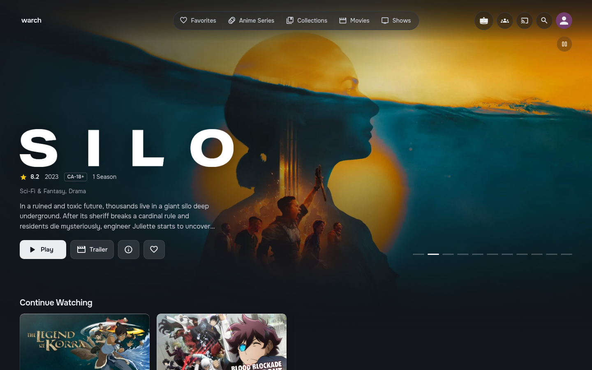
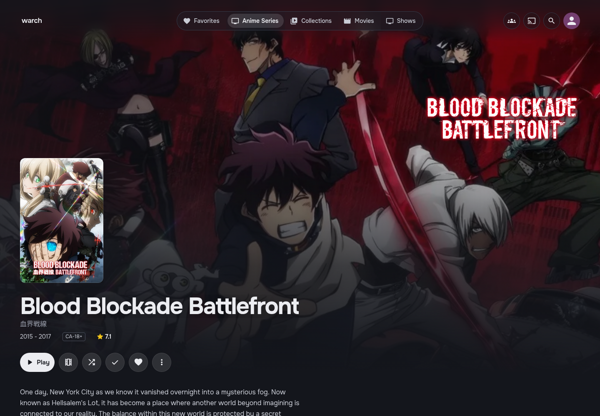

# jellyglass

A dark, glassy theme for the Jellyfin web client. It uses Onest type, rounded Material Symbols and a soft
sheen over all artwork. It is plain CSS plus one optional script: nothing on the server is patched, and
removing it restores the stock look.

Built and checked against jellyfin-web 12.2 (the layout with the Material UI header).




## Install

**Theme.** Dashboard → General → Custom CSS, add:

```css
@import url("https://cdn.jsdelivr.net/gh/leykhins/jellyglass@main/theme/jellyglass.css");
```

Save and reload the web client. Keep **Dark** selected under Settings → Display, because the theme loads on top of it.

**My Media posters (optional).** `theme/jellyglass.js` adds each library's three newest posters and its item
count to the My Media tiles. Without it, the tiles still show their tint, icon and name. Install the
**JavaScript Injector** plugin (which needs **File Transformation**), add a script with *Requires authentication*
ticked, and paste:

```js
(function () {
  var s = document.createElement("script");
  s.src = "https://cdn.jsdelivr.net/gh/leykhins/jellyglass@main/theme/jellyglass.js";
  document.head.appendChild(s);
})();
```

**Offline.** `dist/jellyglass.local.css` is the same theme with its fonts embedded, so it never needs the internet.
Paste the whole file into Custom CSS instead of the `@import` line. For the posters, paste the whole of
`theme/jellyglass.js` into JavaScript Injector instead of the loader. Icons the build doesn't include fall back to
Jellyfin's own bundled icon font. To change which icons are embedded, edit `tools/icons.txt`, then rebuild with
`python tools/build_local.py` (needs `pip install fonttools brotli`).

jsDelivr caches `@main` for up to 12 hours. To pick up a change sooner, purge the cache by opening
`https://purge.jsdelivr.net/gh/leykhins/jellyglass@main/theme/jellyglass.css`, and the same address for `jellyglass.js`.

## Home hero

The banner is styled for the **Media Bar Enhanced** plugin. For key art instead of trailer footage,
turn off *Enable video backdrop* in its settings. If the Abyss spotlight is still installed, jellyglass hides it.

## What it covers

Header and library nav, home hero, My Media tiles, home rows and cards, library grids, title pages
(movie, series, season, episode list), cast, sign in, menus and dialogs, form fields, and the video player.

## Known gaps

- **Anime icon.** Libraries only expose their type, so the anime icon in the header is tied to one server's
  library id (search the CSS for `animation`). On the My Media tiles, any TV library whose folder path contains
  "anime" gets it automatically.
- **Sign-in profiles.** "Who's watching?" circles only appear for users who aren't hidden from the login screen.
- **Admin dashboard.** Gets the palette and type, but not a redesigned layout.

## Licences

Fonts embedded in the offline build: Onest (SIL Open Font License 1.1) and Material Symbols (Apache License 2.0).
